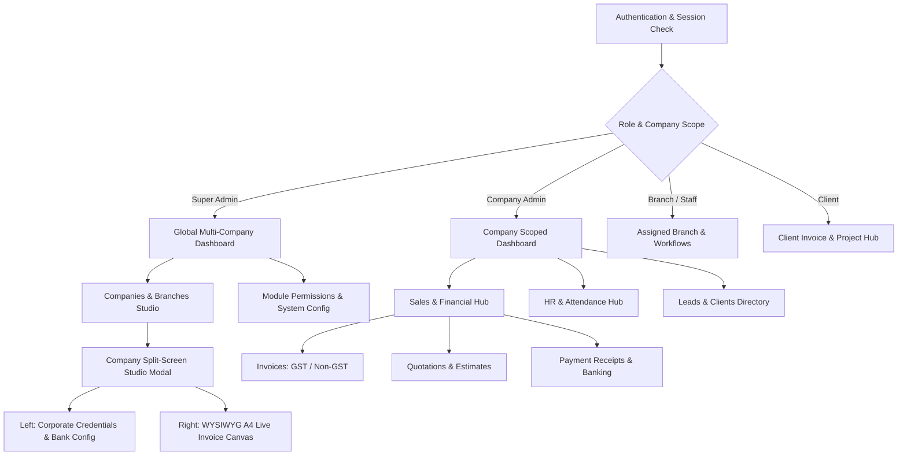
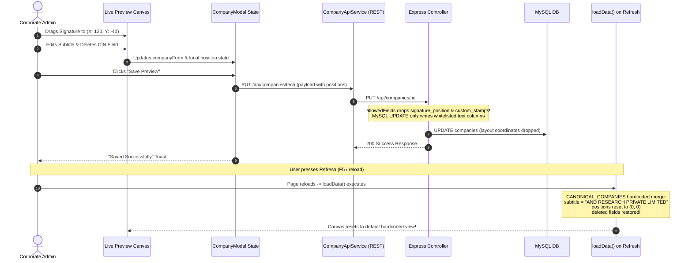
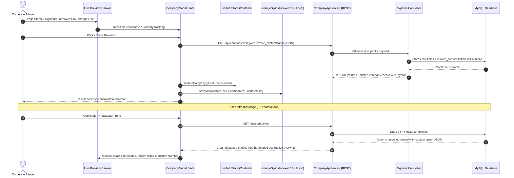
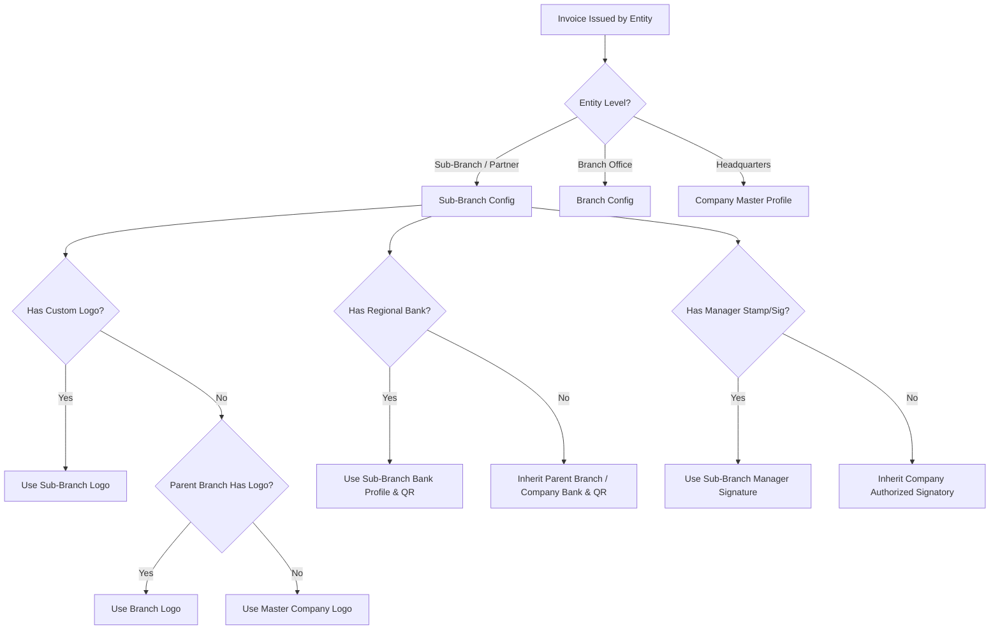
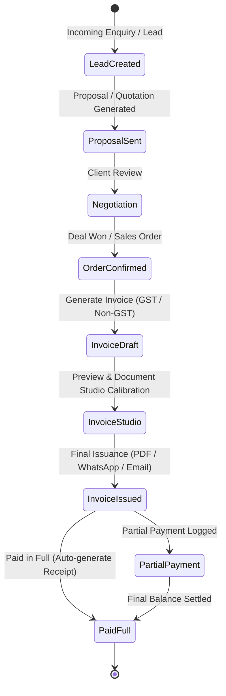
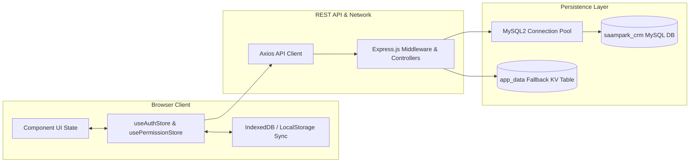

# Application Flow & Data Architecture (Appflow)
## Project: SAAMPARK Group Enterprise CRM

**Document Version:** 1.0.0  
**Scope:** Navigation Paths, User Journeys, State Synchronization Lifecycle, and Studio Data Pipelines

---

## 1. System Navigation & High-Level Architecture Flow

---

## 2. Detailed Journey: Company Management & Invoice Preview Studio

### 2.1 The Issue: Current Broken Flow vs. Target Fixed Flow

#### Broken Flow (Current State):

#### Remediation Flow (Target Production Architecture):

---

## 3. Multi-Tier Entity Inheritance & Fallback Flow

In SAAMPARK CRM, documents can be issued by a **Parent Company**, an **Operational Branch**, or a **Franchise Sub-Branch**. The system resolves branding and banking credentials using strict hierarchical precedence:

### Inheritance Priority Rules:
1. **Logo & Identity:** `Sub-Branch Override` > `Branch Override` > `Company Master`
2. **Tax & Legal IDs:** Sub-Branches display their parent branch/company GSTIN & PAN unless registered as an independent corporate entity.
3. **Banking & UPI:** Invoices automatically bind to the specified **GST Bank Profile** (if tax > 0%) or **Non-GST Bank Profile** (if 0% tax), cascading from Sub-Branch -> Branch -> Company.
4. **Signatures & Seal:** If a branch manager's stamp/signature is uploaded, it takes precedence on local branch invoices; otherwise, the corporate managing director signature applies.

---

## 4. Sales Pipeline & Document Lifecycle Flow

---

## 5. State Synchronization & Persistence Architecture

The platform combines a tripartite state model to ensure offline-readiness, cross-tab synchronization, and server-side truth:

### Synchronization Sequence:
1. **Component Modification:** Inline text typing or drag events update local component state immediately for zero-latency 60 FPS visual feedback.
2. **Debounced / Explicit Save:** Clicking "Save Preview" or "Save Company" packages the full entity document state.
3. **Primary Persistence:** Dispatches `PUT /api/companies/:id` to Express backend and persists to MySQL relational tables.
4. **Secondary Cache Sync:** Dispatches `saveModuleDataToDB("companies", list)` to the fast KV table `app_data` and updates Zustand memory.
5. **Cross-Tab Event Dispatch:** Fires `window.dispatchEvent(new CustomEvent('saampark_company_updated'))` and `storage` events to ensure all open CRM tabs synchronize their invoice headers instantly.
