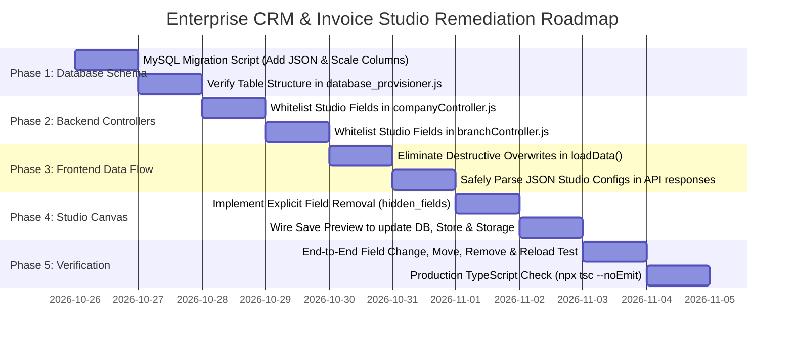

# Implementation & Remediation Plan (Plan)
## Project: SAAMPARK Group Enterprise CRM & Invoice Studio Fix

**Document Version:** 1.0.0  
**Status:** Ready for Execution  
**Primary Goal:** Permanently resolve the live invoice preview field customization & position persistence defect while maintaining strict data integrity across the multi-tenant CRM.

---

## 1. Project Phase Breakdown & Roadmap

---

## 2. Phase-by-Phase Execution Plan

### Phase 1: Database Migration & Schema Expansion
- **Objective:** Provision missing relational and JSON columns in MySQL so the database can store visual coordinates, custom stamps, scales, and field visibility sets.
- **Tasks:**
  1. Create database migration script `backend/src/migrations/add_studio_columns.js` (or execute via `ensure_db.js`).
  2. Alter `companies` table to add:
     - `iso_certification` (VARCHAR(255))
     - `signature_position` (JSON)
     - `stamp_position` (JSON)
     - `logo_position` (JSON)
     - `logo_scale` (DECIMAL(3,2) DEFAULT 1.00)
     - `stamp_scale` (DECIMAL(3,2) DEFAULT 1.00)
     - `signature_scale` (DECIMAL(3,2) DEFAULT 1.00)
     - `custom_stamps` (JSON)
     - `invoice_customization` (JSON)
  3. Alter `branches` table with matching studio columns.
  4. Update `backend/database_provisioner.js` to ensure fresh deployments automatically create these columns.

---

### Phase 2: Backend Controller Whitelisting & Deserialization
- **Objective:** Allow Express controllers to accept, serialize, and persist the new studio columns without dropping them.
- **Tasks:**
  1. Open `backend/src/controllers/companyController.js`.
  2. Expand `allowedFields` to include all studio attributes (`iso_certification`, `signature_position`, `stamp_position`, `logo_position`, `logo_scale`, `stamp_scale`, `signature_scale`, `custom_stamps`, `invoice_customization`).
  3. Ensure objects passed in `req.body` (like `{ x: 120, y: 40 }` or stamp arrays) are safely transformed with `JSON.stringify()` before raw SQL execution.
  4. Ensure `getAllCompanies` and `getCompanyById` parse stored JSON strings back into native objects before responding to clients.
  5. Apply identical updates to `backend/src/controllers/branchController.js`.

---

### Phase 3: Frontend Data Hydration Remediation
- **Objective:** Stop `loadData()` from forcibly overwriting user-saved company attributes with hardcoded strings on page load.
- **Tasks:**
  1. Open `frontend/src/app/feature/companies/index.tsx`.
  2. Locate `loadData()` (around lines 406–432).
  3. Remove the destructive hardcoded overrides:
     - Replace hardcoded `brand_name: "SAAMPARK"` with `dbComp.brand_name ?? "SAAMPARK"`.
     - Replace hardcoded `division_name: "TECHNOLOGY"` with `dbComp.division_name ?? ""`.
     - Replace hardcoded `subtitle: "AND RESEARCH PRIVATE LIMITED"` with `dbComp.subtitle ?? ""`.
     - Replace hardcoded `name: "SAAMPARK TECHNOLOGY AND RESEARCH PRIVATE LIMITED"` with `dbComp.name ?? "SAAMPARK"`.
  4. Safely parse `signature_position`, `stamp_position`, `custom_stamps`, and `invoice_customization` if returned as strings from the server.
  5. Ensure `saveCompany()` passes the complete payload to `CompanyApiService.update(targetId, payload)` and syncs into `useAuthStore` and `storageSync`.

---

### Phase 4: Invoice Preview Studio & Field Visibility Enhancement
- **Objective:** Enable true field removal (hiding) and ensure removed fields stay removed across refreshes.
- **Tasks:**
  1. Open `frontend/src/app/feature/sales/invoices/components/OfficialInvoiceDocument.tsx`.
  2. Introduce `hiddenFields?: string[]` prop and `onToggleFieldVisibility?: (fieldKey: string) => void`.
  3. Update field rendering logic so that if a field key (e.g. `cin`, `iso_certification`, `subtitle`, `msme_reg`) is present in `hiddenFields`, it is completely omitted from the canvas.
  4. Add subtle hover delete buttons on optional metadata fields in interactive studio mode.
  5. Store `hidden_fields` inside `invoice_customization.hidden_fields`.
  6. Wire the "Save Preview" button in `companies/index.tsx` to commit both `companyForm`, `signature_position`, `stamp_position`, `custom_stamps`, and `invoice_customization` atomically.

---

### Phase 5: Verification & End-to-End Validation
- **Objective:** Validate that all user modifications persist permanently across reloads.
- **Tasks:**
  1. Open the Company Edit Studio in the browser.
  2. Modify Corporate Subtitle to a custom string (e.g. `"Enterprise AI Division"`).
  3. Move the corporate seal stamp 50px to the right and scale the signature to `1.25x`.
  4. Remove the `CIN` field.
  5. Add a custom `"CONFIDENTIAL"` stamp in crimson red rotated at `-12°`.
  6. Click "Save Preview". Verify "Saved Successfully!" confirmation.
  7. Hard refresh the page (`Ctrl + F5`).
  8. Re-open Company Edit Studio:
     - Verify Subtitle is `"Enterprise AI Division"`.
     - Verify stamp is positioned at the new coordinates.
     - Verify signature scale is `1.25x`.
     - Verify CIN field remains hidden.
     - Verify `"CONFIDENTIAL"` stamp is rendered exactly where placed.
  9. Run `npx tsc --noEmit` in `frontend` to guarantee 0 TypeScript compilation errors.

---

## 3. Test Cases & Validation Matrix

| Test Case ID | Test Description | Expected Result | Pass/Fail Criteria |
|---|---|---|---|
| **TC-STU-01** | Edit Company Name & Subtitle in canvas, Save & Reload | Name & Subtitle retain user-edited text | Text must NOT revert to "AND RESEARCH PRIVATE LIMITED" |
| **TC-STU-02** | Move Signature to (X: 150, Y: -30), Save & Reload | Coordinates (150, -30) restored from DB | Signature renders at exact dragged position |
| **TC-STU-03** | Scale Company Logo to 1.40x, Save & Reload | Logo scale multiplier remains 1.40x | Visual size preserved |
| **TC-STU-04** | Remove CIN field via canvas action, Save & Reload | CIN field remains hidden | Field does NOT reappear as placeholder or fallback |
| **TC-STU-05** | Add "PAID" custom stamp, Save & Reload | "PAID" badge renders at saved coordinates & angle | Array restored from `custom_stamps` JSON |
| **TC-STU-06** | Switch between GST and Non-GST invoice previews | Bank profiles switch between GST and Non-GST accounts | Proper banking details bind without data bleeding |

---

## 4. Definition of Done (DoD)

- [x] All 6 architectural documentation files (`prd.md`, `appflow.md`, `ui-spec.md`, `trd.md`, `schema.md`, `plan.md`) exist and are synchronized.
- [ ] Database migration executed cleanly with no regression to existing company/branch data.
- [ ] Backend controllers whitelist and persist all studio layout and coordinate columns.
- [ ] Frontend `loadData()` preserves database state without destructive hardcoded string overrides.
- [ ] Studio canvas supports true field removal and reordering with permanent retention on refresh.
- [ ] TypeScript check (`npx tsc --noEmit`) passes with zero errors.
