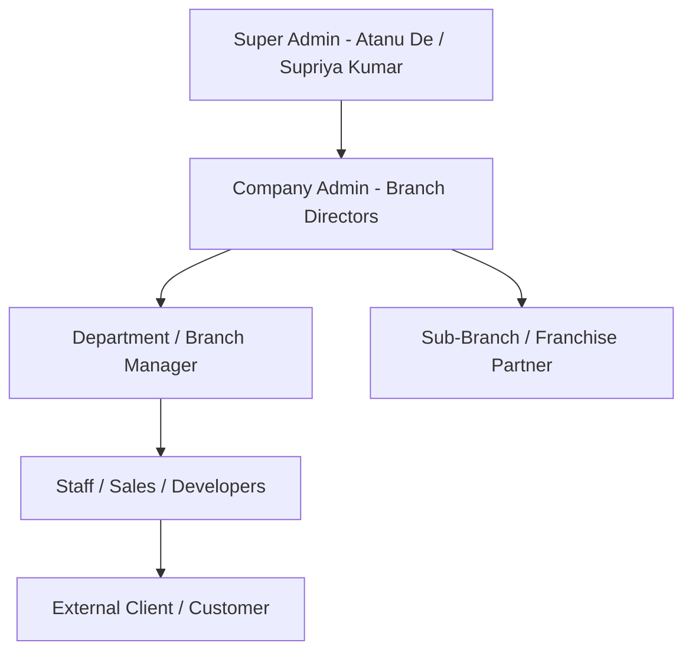
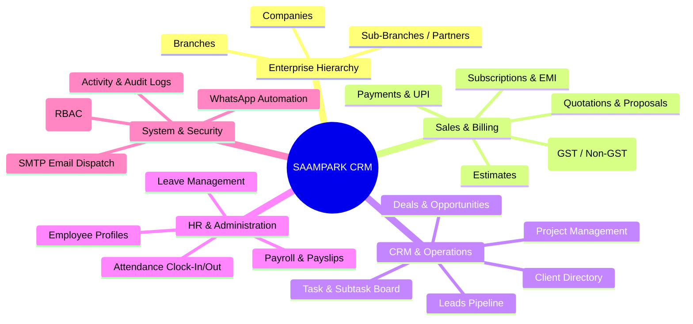

# Product Requirements Document (PRD)
## Project: SAAMPARK Group Enterprise CRM & Multi-Tier Business Management Platform

**Document Version:** 1.0.0  
**Status:** Approved for Implementation  
**Target Environment:** Node.js (Express) + MySQL + Next.js (App Router, Tailwind CSS, Framer Motion)

---

## 1. Executive Summary & Product Vision

### 1.1 Executive Summary
**SAAMPARK CRM** is a centralized, multi-tenant enterprise management platform designed to unify the diverse business operations of the Saampark Group (including *Saampark Technology & Research*, *Saampark Consultancy Services*, *Saampark Digital Media*, and associated franchise/regional partners). The platform manages the entire lifecycle of corporate administration, client relationships, multi-tier organizational hierarchies (Companies, Branches, Sub-Branches), sales pipeline, automated billing/invoicing with GST/Non-GST compliance, HR/payroll, team operations, and client communication channels (WhatsApp, Email SMTP).

### 1.2 Core Problem Statement
Users in the **Companies & Organizational Management** module customize corporate invoice documents via an interactive **Live Invoice Preview Studio** (moving company logos, modifying or removing specific fields like CIN/GSTIN/PAN/address/bank profiles, reordering elements, repositioning official seals and authorized signatures, and stamping custom badges like "PAID" or "CONFIDENTIAL"). 

**The Critical Defect Identified:**
> *"In companies section invoice preview section those fields we have changed or those field we removed or moved even after saved and refresh all changes are back to previous."*

1. **Destructive State Overwrite on Refresh:** On every browser reload, frontend `loadData()` routines execute hardcoded transformations over the fetched database entities, forcibly resetting company attributes (`name`, `brand_name`, `division_name`, `subtitle`, `logo_url`) back to hardcoded default strings.
2. **Backend Column & Controller Dropping:** The MySQL `companies` table schema and Express `companyController.js` whitelist omit document studio positioning coordinates (`signature_position`, `stamp_position`, `logo_scale`, `custom_stamps`, and `invoice_layout_config`), causing the backend to drop these visual custom configurations silently upon API save.
3. **Absence of Real Field-Level Deletion / Visibility Tracking:** When a user removes a text field in the live canvas, the component treats empty values as null/undefined and falls back to system defaults instead of persisting a deliberate "hidden/removed" flag.

### 1.3 Vision & Objective
Deliver an enterprise-grade, high-fidelity CRM where:
- Corporate identities and multi-tier organizational units maintain strict data sovereignty and persistence.
- The **Live Document & Invoice Studio** provides a true WYSIWYG editing canvas where text modifications, field deletions, element reordering, stamp scaling, and signature coordinates persist permanently across refreshes, session lifecycles, and device transitions.

---

## 2. User Personas & Role Hierarchy

### 2.1 Persona Matrix
| Role | Access Scope | Primary Objectives & Tasks |
|---|---|---|
| **Super Admin** | Global (All Companies & Branches) | System governance, tenant provisioning, global module permission toggling, database schema migration, master audit logging, corporate brand templates. |
| **Company Admin** | Single Assigned Company + Child Branches | Branch setup, staff assignments, sales & financial reporting, document customization (signatures, bank profiles, invoice header layouts), client CRM oversight. |
| **Branch Manager** | Branch / Sub-Branch Scope | Local client pipeline, sales orders, attendance approval, branch-specific document overrides (local manager signature, regional bank account). |
| **Employee / Sales Rep** | Assigned Records / Leads / Invoices | Lead qualification, task execution, generating customer quotations, tracking payments, logging work timesheets. |
| **Sub-Branch / Franchise** | Partner-Specific Sub-Branch | Generating client invoices with inherited parent company credentials, customized partner branding badge, localized UPI QR codes. |
| **External Client** | Public Portal / Secure Link | Reviewing quotations, viewing issued GST/Non-GST invoices, downloading PDF bills, making online UPI payments. |

---

## 3. High-Priority Functional Requirements (Live Invoice Studio & Persistence)

### 3.1 Live Invoice Interactive Studio & Field Customization (FR-INV-01)
- **FR-INV-01.1 Direct Inline Editing:** Users must be able to click any text element on the invoice preview (Company Name, Division, Subtitle, CIN, GSTIN, PAN, Registered Address, Phone, Email, Website, Bank Name, Account Number, IFSC, UPI ID, Terms & Conditions, and Notes) to edit content directly in the canvas.
- **FR-INV-01.2 Element Repositioning (Drag & Drop):** Authorized signatures, company seals/stamps, and custom text badges must be draggable anywhere across the A4 canvas using smooth, coordinate-aware handles (`x, y` offsets).
- **FR-INV-01.3 Scaling & Zoom Controls:** Users must be able to independently scale the company logo (`logo_scale`), stamp (`stamp_scale`), and signature (`signature_scale`) from 0.5x to 2.5x with instant live visual feedback.
- **FR-INV-01.4 Field Deletion & Visibility Toggles:** Users must have the ability to explicitly remove/hide fields (e.g., hide CIN, hide ISO badge, suppress Division name, omit bank branch). When removed, the field must remain hidden permanently and NOT revert to defaults on refresh.
- **FR-INV-01.5 Custom Text & Stamp Badges:** Allow adding dynamic badges (`PAID`, `SEAL`, `CONFIDENTIAL`, or custom text) with selectable font sizes, rotation angles, colors, and border styles.
- **FR-INV-01.6 Dual Profile Preview (GST vs. Non-GST):** Instant toggle between 18% GST itemized invoice format and 0% Non-GST format with corresponding bank profile and legal identifier displays.

### 3.2 Persistent Data Pipeline & Storage Integrity (FR-INV-02)
- **FR-INV-02.1 End-to-End Persistence:** All visual coordinates, custom stamps, hidden field sets, and edited textual fields must be transmitted via REST API and persisted in the MySQL database under structured JSON columns (`invoice_customization`, `signature_position`, `stamp_position`, `custom_stamps`).
- **FR-INV-02.2 Safe Data Hydration:** Frontend hydration (`loadData()`) must respect and preserve user-saved values from the database and MUST NEVER overwrite saved fields with hardcoded defaults.
- **FR-INV-02.3 Instant Feedback:** The "Save Preview" button must execute atomic updates to both MySQL, Zustand store, and browser local cache, showing definitive success feedback ("Saved Successfully!") and remaining stable on reload.

---

## 4. Comprehensive Enterprise Modules Overview

### 4.1 Enterprise Multi-Tier Hierarchy
- **Companies:** Master business entities with independent legal identity, GSTIN/PAN/CIN, banking profiles (dual GST & Non-GST), SMTP configurations, and authorized signatory profiles.
- **Branches:** Operational regional offices (e.g. Mumbai HO, Kolkata Tech Park) linked to a parent company, capable of inheriting or overriding company bank details and document branding.
- **Sub-Branches / Partners:** Regional associates or franchise offices operating under a parent branch, with partner-specific contact and commission structures.

### 4.2 Sales & Financial Management
- **Invoices:** Official tax and commercial invoices with auto-generated serial numbering (`INV-TECH-2026-001`), tax breakdowns (CGST + SGST or IGST), dual banking profiles, dynamic QR codes, and downloadable print-ready A4 PDFs.
- **Quotations & Estimates:** Formal pre-sales quotes with one-click conversion into active sales orders or final invoices.
- **Payments & Receipts:** Payment tracking against invoices with support for cash, bank transfer, UPI, and partial payment logs.
- **Subscriptions & EMI:** Recurring billing automation with cycle intervals (monthly, quarterly, annually) and milestone-based installment plans.

### 4.3 CRM, Leads & Project Delivery
- **Leads Pipeline:** Kanban and list views of incoming prospects, status stages (New, Contacted, Qualified, Proposal, Won, Lost), and source tracking.
- **Client Directory:** Consolidated client accounts, contract histories, billed revenues, and document vaults.
- **Projects & Tasks:** Milestone-driven project tracking with integrated timesheets, task assignments, priorities, and deadline monitoring.

### 4.4 Human Resources & Team Management
- **Employees & Designations:** Corporate directory with department structures, reporting lines, and digital ID card generation.
- **Attendance & Timesheets:** Daily clock-in/clock-out tracking, working hour calculation, and geolocation tagging.
- **Leave Management:** Leave applications, leave balance allocation (Casual, Sick, Earned), and multi-level manager approvals.
- **Payroll:** Monthly payroll generation, allowances/deductions computation, and automated salary slip issuance.

### 4.5 Communications & Automations
- **SMTP Gateway:** Multi-tenant SMTP configuration (Gmail, Zoho, Outlook, Custom) with in-app test dispatch handshake.
- **WhatsApp Automation Engine:** Webhook-driven templates and instant client notification dispatch for billing reminders and payment receipts.
- **Audit & Activity Logs:** Comprehensive logging of user sessions, IP addresses, data mutations, and deletion events.

---

## 5. Non-Functional Requirements (NFR)

| Metric | Requirement | Target Threshold |
|---|---|---|
| **Data Integrity** | Zero data loss on company document edits, positioning, and field customization. | 100% persistence across reloads |
| **Response Latency** | API save latency for company/branch document configurations. | < 250ms |
| **Canvas Frame Rate** | Dragging signatures, stamps, and logos on the live preview canvas. | 60 FPS (Framer Motion) |
| **Print & Export Fidelity** | Exported invoice PDFs and browser print view must match A4 dimensions exactly. | Pixel-perfect 794px × 1123px (A4 @ 96 DPI) |
| **Tenant Isolation** | Non-Super Admin users cannot view or manipulate data belonging to other corporate entities. | Strict row-level company_id filtering |
| **Browser Compatibility** | Modern Chromium (Chrome, Edge), Firefox, Safari, and mobile viewports. | Seamless cross-browser layout parity |

---

## 6. Success Metrics & Acceptance Criteria

1. **Acceptance Criteria 1 (Field Modification):** When a user updates any text field on the invoice preview canvas (e.g., changing the Corporate Subtitle or Bank Name) and clicks "Save Preview", refreshing the page (`F5` or `Ctrl+R`) must display the updated text without reverting.
2. **Acceptance Criteria 2 (Field Removal / Hiding):** When a user removes or clears a field (e.g., removing CIN or ISO certification) and saves, refreshing the page must KEEP that field removed and NOT restore previous placeholders or canonical text.
3. **Acceptance Criteria 3 (Positioning & Scale Retention):** When a user drags the signature or corporate stamp to a new coordinate and scales the company logo to 1.35x, saving and refreshing must load the exact same coordinates and scale values.
4. **Acceptance Criteria 4 (Custom Stamps Persistence):** Any added custom stamp (such as "PAID" in emerald green at -12° rotation) must be saved in the database and restored in the exact position and styling upon page reload.
