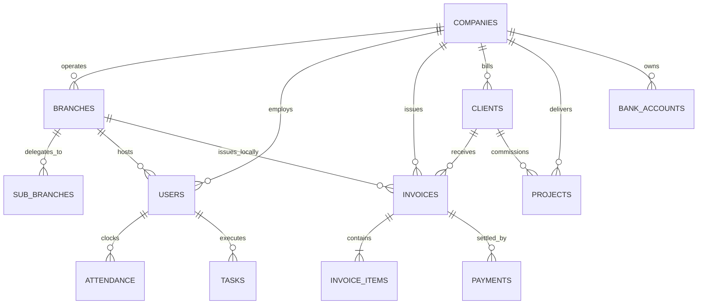

# Database & State Schema Specification (Schema)
## Project: SAAMPARK Group Enterprise CRM

**Document Version:** 1.0.0  
**Database Engine:** MySQL 8.0 / InnoDB / utf8mb4_unicode_ci  
**Client State Management:** Zustand + TypeScript Strong Typing

---

## 1. Entity-Relationship Overview



---

## 2. Relational Database Tables

### 2.1 Table: `companies`
Represents the top-level corporate entities. Enhanced with live document studio configuration columns.

| Column Name | Data Type | Nullable | Default | Description |
|---|---|---|---|---|
| `id` | INT AUTO_INCREMENT | NO | PRIMARY KEY | Numeric entity identifier |
| `name` | VARCHAR(255) | NO | | Full official registered legal name |
| `slug` | VARCHAR(100) | NO | UNIQUE | URL-safe identifier (e.g. `tech`, `consultancy`) |
| `brand_name` | VARCHAR(100) | YES | NULL | Brand prefix (e.g. `SAAMPARK`) |
| `division_name` | VARCHAR(100) | YES | NULL | Business division (e.g. `TECHNOLOGY`) |
| `subtitle` | VARCHAR(255) | YES | NULL | Corporate subtitle / tagline |
| `iso_certification` | VARCHAR(255) | YES | NULL | Quality certification badge text |
| `industry` | VARCHAR(100) | YES | 'Technology' | Sector category |
| `currency` | VARCHAR(10) | YES | 'INR' | Default billing currency code |
| `currency_symbol` | VARCHAR(5) | YES | '₹' | Currency symbol display |
| `logo_url` | TEXT | YES | NULL | URL / Path to official high-res logo |
| `address` | TEXT | YES | NULL | Registered corporate office address |
| `city` | VARCHAR(100) | YES | NULL | City |
| `state` | VARCHAR(100) | YES | NULL | State / Province |
| `zip` | VARCHAR(20) | YES | NULL | Postal Code |
| `country` | VARCHAR(100) | YES | 'India' | Country |
| `phone` | VARCHAR(100) | YES | NULL | Primary corporate telephone |
| `email` | VARCHAR(150) | YES | NULL | Official contact email |
| `website` | VARCHAR(150) | YES | NULL | Official website URL |
| `gstin` | VARCHAR(50) | YES | NULL | Goods & Services Tax ID |
| `pan` | VARCHAR(50) | YES | NULL | Permanent Account Number |
| `cin` | VARCHAR(50) | YES | NULL | Corporate Identification Number |
| `msme_reg` | VARCHAR(50) | YES | NULL | MSME / Udyam registration ID |
| `status` | VARCHAR(20) | YES | 'active' | Entity status (`active`, `inactive`) |
| `signatory_name` | VARCHAR(100) | YES | NULL | Name of managing director / authorized signatory |
| `signatory_designation` | VARCHAR(100) | YES | NULL | Official designation |
| `signature_image_url` | TEXT | YES | NULL | PNG transparent signature scan URL |
| `stamp_image_url` | TEXT | YES | NULL | Corporate seal / rubber stamp graphic URL |
| `terms_conditions` | TEXT | YES | NULL | Standard invoice payment terms & legal clauses |
| `invoice_notes` | TEXT | YES | NULL | Standard customer gratitude & remittance note |
| `quotation_notes` | TEXT | YES | NULL | Standard quotation validity statement |
| **GST Banking Profile** | | | | |
| `gst_bank_name` | VARCHAR(150) | YES | NULL | Bank name for GST tax invoices |
| `gst_account_holder`| VARCHAR(150) | YES | NULL | Account beneficiary name |
| `gst_account_number`| VARCHAR(100) | YES | NULL | Current account number |
| `gst_ifsc_code` | VARCHAR(50) | YES | NULL | IFSC code |
| `gst_bank_branch` | VARCHAR(150) | YES | NULL | Bank branch name |
| `gst_upi_id` | VARCHAR(100) | YES | NULL | Business UPI VPA |
| `gst_payment_qr_url`| TEXT | YES | NULL | Dynamic UPI QR image URL |
| **Non-GST Banking Profile** | | | | |
| `nongst_bank_name` | VARCHAR(150) | YES | NULL | Bank name for Non-GST/exempt invoices |
| `nongst_account_holder`| VARCHAR(150) | YES | NULL | Account beneficiary name |
| `nongst_account_number`| VARCHAR(100) | YES | NULL | Account number |
| `nongst_ifsc_code` | VARCHAR(50) | YES | NULL | IFSC code |
| `nongst_bank_branch`| VARCHAR(150) | YES | NULL | Bank branch name |
| `nongst_upi_id` | VARCHAR(100) | YES | NULL | UPI VPA |
| `nongst_payment_qr_url`| TEXT | YES | NULL | UPI QR image URL |
| **Document Studio Calibration** | | | | |
| `signature_position`| JSON | YES | NULL | Drag coordinate offset `{ "x": INT, "y": INT }` |
| `stamp_position` | JSON | YES | NULL | Drag coordinate offset `{ "x": INT, "y": INT }` |
| `logo_position` | JSON | YES | NULL | Logo coordinate offset `{ "x": INT, "y": INT }` |
| `logo_scale` | DECIMAL(3,2) | YES | 1.00 | Zoom scale multiplier (0.50 to 2.50) |
| `stamp_scale` | DECIMAL(3,2) | YES | 1.00 | Stamp scale multiplier (0.50 to 2.50) |
| `signature_scale` | DECIMAL(3,2) | YES | 1.00 | Signature scale multiplier (0.50 to 2.50) |
| `custom_stamps` | JSON | YES | NULL | Array of custom text stamps/badges |
| `invoice_customization`| JSON | YES | NULL | Field visibility & layout config |
| `created_at` | TIMESTAMP | NO | CURRENT_TIMESTAMP | Record creation time |
| `updated_at` | TIMESTAMP | NO | ON UPDATE CURRENT_TIMESTAMP | Last modification time |

---

### 2.2 Table: `branches`
Regional branches operating under a company.

| Column Name | Data Type | Nullable | Description |
|---|---|---|---|
| `id` | INT AUTO_INCREMENT | NO (PK) | Unique branch ID |
| `company_id` | VARCHAR(100) | NO | Foreign key linking to parent company (`id` or `slug`) |
| `name` | VARCHAR(150) | NO | Regional branch name |
| `code` | VARCHAR(50) | YES | Branch abbreviation (e.g. `HO-MUM`) |
| `city` | VARCHAR(100) | YES | Operating city |
| `state` | VARCHAR(100) | YES | Operating state |
| `address` | TEXT | YES | Office physical location |
| `phone` | VARCHAR(100) | YES | Branch contact telephone |
| `email` | VARCHAR(150) | YES | Branch contact email |
| `manager_name` | VARCHAR(100) | YES | Branch manager / supervisor name |
| `manager_phone` | VARCHAR(50) | YES | Branch manager contact |
| `logo_url` | TEXT | YES | Branch-specific logo override |
| `signature_image_url` | TEXT | YES | Branch manager signature scan |
| `stamp_image_url` | TEXT | YES | Branch official seal scan |
| `signature_position` | JSON | YES | Coordinates `{ "x": INT, "y": INT }` |
| `stamp_position` | JSON | YES | Coordinates `{ "x": INT, "y": INT }` |
| `custom_stamps` | JSON | YES | Array of custom badges |
| `invoice_customization` | JSON | YES | Field visibility overrides |
| `status` | VARCHAR(20) | YES | `Active`, `Inactive` |
| `created_at` | TIMESTAMP | NO | Creation timestamp |

---

### 2.3 Table: `invoices` & `invoice_items`

#### Table: `invoices`
| Column Name | Data Type | Description |
|---|---|---|
| `id` | INT AUTO_INCREMENT | PK |
| `company_id` | INT / VARCHAR(100) | Issuing company |
| `branch_id` | INT | Issuing branch (optional) |
| `sub_branch_id` | INT | Issuing sub-branch / partner (optional) |
| `client_id` | INT | Billed customer |
| `invoice_number` | VARCHAR(50) | Serial invoice ID (e.g. `INV-TECH-2026-001`) |
| `subtotal` | DECIMAL(12,2) | Pre-tax sum of items |
| `tax_amount` | DECIMAL(12,2) | Total GST / tax calculated |
| `total_amount` | DECIMAL(12,2) | Net payable bill amount |
| `paid_amount` | DECIMAL(12,2) | Amount credited to date |
| `status` | VARCHAR(50) | `Draft`, `Unpaid`, `Partially_paid`, `Paid`, `Overdue` |
| `scheme` | VARCHAR(20) | `gst` (18%), `nongst` (0%) |
| `due_date` | DATE | Payment deadline |
| `created_at` | TIMESTAMP | Invoice issuance date |

#### Table: `invoice_items`
| Column Name | Data Type | Description |
|---|---|---|
| `id` | INT AUTO_INCREMENT | PK |
| `invoice_id` | INT | Foreign key to parent `invoices.id` |
| `description` | VARCHAR(255) | Service or product description |
| `sac_code` | VARCHAR(50) | HSN / SAC statutory service code |
| `quantity` | DECIMAL(10,2) | Quantity / units delivered |
| `unit_price` | DECIMAL(12,2) | Price per single unit |
| `gst_rate` | DECIMAL(5,2) | GST rate percentage (e.g. `18.00`) |
| `total` | DECIMAL(12,2) | Line total amount |

---

## 3. JSON Document Schemas (Document Studio Calibration)

### 3.1 `custom_stamps` JSON Schema
Represents an array of interactive draggable badges placed on the invoice canvas:

```json
[
  {
    "id": "stamp-1729938491029",
    "text": "PAID",
    "color": "#0d9488",
    "rotation": -12,
    "fontSize": 14,
    "bgStyle": "stamp",
    "x": 180,
    "y": 320
  },
  {
    "id": "stamp-1729938499999",
    "text": "OFFICIAL CORPORATE COPY",
    "color": "#2563eb",
    "rotation": 0,
    "fontSize": 11,
    "bgStyle": "badge",
    "x": 30,
    "y": -15
  }
]
```

### 3.2 `invoice_customization` JSON Schema
Represents layout preferences, explicit field removals, and type presets:

```json
{
  "hidden_fields": [
    "cin",
    "iso_certification",
    "bank_branch"
  ],
  "preview_invoice_type": "gst",
  "logo_position": { "x": 0, "y": 0 },
  "notes_position": { "x": 0, "y": 0 }
}
```

---

## 4. TypeScript Client Interfaces

```typescript
// Core Company Interface
export interface Company {
  id: string
  name: string
  slug: string
  brand_name?: string
  division_name?: string
  subtitle?: string
  iso_certification?: string
  industry?: string
  currency?: string
  currency_symbol?: string
  logo_url?: string
  address?: string
  city?: string
  state?: string
  zip?: string
  country?: string
  phone?: string
  email?: string
  website?: string
  gstin?: string
  pan?: string
  cin?: string
  msme_reg?: string
  status?: "active" | "inactive"
  member_count?: number

  // Signatory & Stamp
  signatory_name?: string
  signatory_designation?: string
  signature_image_url?: string
  stamp_image_url?: string

  // Dual Banking Profiles
  gst_bank_name?: string
  gst_account_holder?: string
  gst_account_number?: string
  gst_ifsc_code?: string
  gst_bank_branch?: string
  gst_upi_id?: string
  gst_payment_qr_url?: string

  nongst_bank_name?: string
  nongst_account_holder?: string
  nongst_account_number?: string
  nongst_ifsc_code?: string
  nongst_bank_branch?: string
  nongst_upi_id?: string
  nongst_payment_qr_url?: string

  // Notes & Clauses
  terms_conditions?: string
  invoice_notes?: string
  quotation_notes?: string

  // Live Canvas Studio Calibration
  signature_position?: { x: number; y: number }
  stamp_position?: { x: number; y: number }
  logo_position?: { x: number; y: number }
  logo_scale?: number
  stamp_scale?: number
  signature_scale?: number
  custom_stamps?: CustomTextStamp[]
  invoice_customization?: InvoiceLayoutConfig
}

// Custom Draggable Text Stamp
export interface CustomTextStamp {
  id: string
  text: string
  color: string
  rotation: number
  fontSize: number
  bgStyle: "stamp" | "badge" | "watermark" | "clean"
  x: number
  y: number
}

// Layout Configuration & Field Visibility
export interface InvoiceLayoutConfig {
  hidden_fields: string[]
  preview_invoice_type?: "gst" | "nongst"
  logo_position?: { x: number; y: number }
  notes_position?: { x: number; y: number }
}
```
